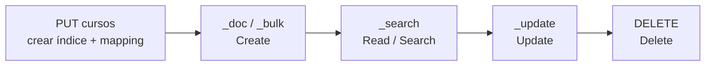

<div align="center">

# OpenSearch Lab
### Instalación local, ingesta de datos, dashboards, *Faceted Search* y API REST

**Taller práctico · Semillero** &nbsp;|&nbsp; **Autor:** _[Tu nombre]_ &nbsp;|&nbsp; **Fecha:** Noviembre 2026

</div>

---

## Agenda

| # | Sección |
|:-:|---|
| 1 | [Contexto y objetivo](#1-contexto-y-objetivo) |
| 2 | [Instalación con Docker Compose](#2-instalación-con-docker-compose) |
| 3 | [Ingesta de datos](#3-ingesta-de-datos) |
| 4 | [Visualizaciones y dashboard](#4-visualizaciones-y-dashboard) |
| 5 | [Faceted Search](#5-faceted-search) |
| 6 | [Administración del índice (CRUD)](#6-administración-del-índice-crud) |
| 7 | [Exploración del API REST](#7-exploración-del-api-rest) |
| 8 | [Persistencia con volúmenes](#8-persistencia-con-volúmenes) |
| 9 | [Retos y soluciones](#9-retos-y-soluciones) |
| 10 | [Resultados y conclusiones](#10-resultados-y-conclusiones) |
| 11 | [Estructura del repositorio](#11-estructura-del-repositorio) |

---

## 1. Contexto y objetivo

> **OpenSearch** es una plataforma *open source* de búsqueda y analítica, derivada de Elasticsearch. Es la alternativa abierta al stack **ELK**.

| Stack ELK | Equivalente OpenSearch | Rol |
|---|---|---|
| Elasticsearch | **OpenSearch** | Motor: almacena, indexa y busca |
| Kibana | **OpenSearch Dashboards** | Interfaz: explora y grafica |
| Logstash | Data Prepper / Logstash | Ingesta: transforma datos en documentos |

### Objetivo
Implementar un entorno de OpenSearch **en local**, cargar un dataset de ejemplo, construir un **dashboard** interactivo con **búsqueda facetada**, practicar la **administración de índices** y consumir directamente el **API REST** del motor, tanto desde línea de comandos (`curl`) como desde Dev Tools.

### Alcance logrado

- [x] Entorno corriendo en local con Docker Compose
- [x] Dataset de ejemplo cargado + documentos propios agregados manualmente
- [x] Dashboard con 4+ visualizaciones
- [x] Faceted search con filtros dinámicos combinables
- [x] CRUD y búsqueda full-text sobre un índice propio
- [x] Exploración del API REST con `curl` y Dev Tools
- [x] Persistencia verificada con volúmenes

---

## 2. Instalación con Docker Compose

### Paso 1 · Preparar el sistema

```bash
# Requerido por OpenSearch en Linux / WSL2
sudo sysctl -w vm.max_map_count=262144

git clone <url-del-repositorio>
cd s2026q4b-opensearch-<nombre>
```

### Paso 2 · Definir la contraseña de admin (`.env`)

```bash
cp .env.example .env     # Luego editar la contraseña dentro de .env
```

```env
OPENSEARCH_INITIAL_ADMIN_PASSWORD=Lab_OpenSearch2026!
```

> **Hallazgo:** desde OpenSearch 2.12 **ya no funciona `admin/admin`**. El plugin de seguridad exige una contraseña fuerte. El archivo `.env` está en `.gitignore` para no subir la contraseña al repositorio.

### Paso 3 · Servicios (`docker-compose.yml`)

<details>
<summary><b>Ver docker-compose.yml completo</b></summary>

```yaml
services:
  opensearch:                                   # Motor de búsqueda
    image: opensearchproject/opensearch:latest
    container_name: opensearch
    environment:
      - cluster.name=opensearch-cluster         # Nombre del clúster
      - node.name=opensearch-node1              # Nombre del nodo
      - discovery.type=single-node              # Clúster de un solo nodo
      - bootstrap.memory_lock=true              # Evita swap
      - "OPENSEARCH_JAVA_OPTS=-Xms512m -Xmx512m" # Memoria de la JVM
      - OPENSEARCH_INITIAL_ADMIN_PASSWORD=${OPENSEARCH_INITIAL_ADMIN_PASSWORD}
    ulimits:
      memlock: { soft: -1, hard: -1 }
      nofile:  { soft: 65536, hard: 65536 }
    volumes:
      - opensearch-data:/usr/share/opensearch/data   # Persistencia
    ports:
      - 9200:9200
      - 9600:9600
    networks:
      - opensearch-net

  opensearch-dashboards:                        # Interfaz web
    image: opensearchproject/opensearch-dashboards:latest
    container_name: opensearch-dashboards
    ports:
      - 5601:5601
    environment:
      OPENSEARCH_HOSTS: '["https://opensearch:9200"]'
    depends_on:
      - opensearch
    networks:
      - opensearch-net

volumes:
  opensearch-data:

networks:
  opensearch-net:
```

</details>

> Basado en el archivo oficial de la [documentación de OpenSearch](https://docs.opensearch.org/latest/install-and-configure/install-opensearch/docker/), simplificado a **un nodo** para un entorno local.

### Paso 4 · Levantar y verificar

```bash
docker compose up -d
docker compose ps
curl -k -u admin:Lab_OpenSearch2026! https://localhost:9200
```

**Resultado:** el clúster responde con `"cluster_name": "opensearch-cluster"` y Dashboards queda disponible en **http://localhost:5601**.

---

## 3. Ingesta de datos

> Código fuente: [`devtools/01-ingesta.txt`](devtools/01-ingesta.txt)

### 3.1 · Dataset de ejemplo

**Home → Add sample data → Sample web logs → Add data**

Crea el índice `opensearch_dashboards_sample_data_logs`, con unos **14.000 documentos** de tráfico web.

```json
GET _cat/indices?v
```

| Campo | Tipo | Uso en el taller |
|---|---|---|
| `timestamp` | date | Eje de tiempo de las gráficas |
| `response` | text + keyword | Código HTTP (200, 404, 503) |
| `machine.os` | text + keyword | Sistema operativo |
| `geo.src` | keyword | País de origen |
| `extension` | text + keyword | Tipo de archivo |
| `host` | text + keyword | Servidor que atendió la petición |
| `bytes` | long | Tamaño de la respuesta |
| `clientip` | ip | IP del cliente |

### 3.2 · Documentos propios (carga manual)

**Un documento con `_doc`:**

```json
POST opensearch_dashboards_sample_data_logs/_doc/mi-log-001
{
  "timestamp": "2026-11-17T15:00:00.000Z",
  "clientip": "190.24.10.5",
  "host": "www.opensearch.org",
  "extension": "php",
  "response": "200",
  "bytes": 5120,
  "geo": { "src": "CO", "dest": "US", "coordinates": { "lat": 4.711, "lon": -74.072 } },
  "machine": { "os": "win 10" },
  "tags": ["success", "ejercicio-manual"],
  "message": "Documento cargado manualmente para el ejercicio"
}
```

**Varios documentos con `_bulk`:**

```json
POST _bulk
{ "index": { "_index": "opensearch_dashboards_sample_data_logs", "_id": "mi-log-002" } }
{ "timestamp": "2026-11-17T16:00:00.000Z", "clientip": "181.50.3.9", "extension": "css", "response": "404", "bytes": 0, "geo": { "src": "CO", "dest": "CO" }, "machine": { "os": "osx" }, "tags": ["error", "ejercicio-manual"], "message": "Archivo no encontrado" }
{ "index": { "_index": "opensearch_dashboards_sample_data_logs", "_id": "mi-log-003" } }
{ "timestamp": "2026-11-17T17:00:00.000Z", "clientip": "200.1.1.1", "extension": "jpg", "response": "503", "bytes": 1024, "geo": { "src": "MX", "dest": "CO" }, "machine": { "os": "ios" }, "tags": ["error", "ejercicio-manual"], "message": "Servicio no disponible" }
```

**Verificación:**

```json
GET opensearch_dashboards_sample_data_logs/_search
{ "query": { "term": { "tags.keyword": "ejercicio-manual" } } }
```

**Resultado:** `hits.total.value = 3`

> **Hallazgos:**
> - `@timestamp` es un **alias** de `timestamp`, así que no se puede escribir en él.
> - `tags` es `text` y se analiza (se parte en `ejercicio` y `manual`). Para buscar el valor exacto se usa `tags.keyword`.

---

## 4. Visualizaciones y dashboard

| # | Visualización | Tipo | Configuración |
|:-:|---|---|---|
| 1 | **KPIs generales de tráfico web** | Metric | `Count` · `Sum(bytes)` · `Unique Count(clientip)` |
| 2 | **Distribución de códigos HTTP en el tiempo** | Vertical Bar | X: `Date Histogram(timestamp)` · Split: `Terms(response)` |
| 3 | **Tendencia del tamaño promedio de respuesta** | Line | Y: `Avg(bytes)` · X: `Date Histogram(timestamp)` |
| 4 | **Tráfico por sistema operativo** | Pie | Split slices: `Terms(machine.os.keyword)` |
| 5 | **Volumen de eventos en el tiempo** | Timeline | `.opensearch(index=..., timefield=timestamp)` |
| 6 | **Conteo de eventos por intervalo** | Vega | Plantilla Vega-Lite filtrada al índice de logs |

<details>
<summary><b>Expresión Timeline</b></summary>

```
.opensearch(index=opensearch_dashboards_sample_data_logs, timefield=timestamp).label('Peticiones web').title('Volumen de eventos en el tiempo')
```

</details>

### Dashboard final
**Dashboards → Create new dashboard → Add** (visualizaciones) **→ Save** con *Store time with dashboard*.

Nombre: **Dashboard Logs – Ejercicio OpenSearch**

**Lectura de los datos:** la mayoría de las peticiones responden **200** (éxito). El tráfico se concentra en franjas específicas del día y los errores **404** y **503** aparecen de forma dispersa.

---

## 5. Faceted Search

> La **búsqueda facetada** permite refinar resultados combinando filtros por categoría. Cada faceta muestra los valores disponibles, y al seleccionarlos se recalculan todas las gráficas.

### Panel de facetas (visualización *Controls*)

| Faceta | Control | Campo |
|---|---|---|
| País origen | Options list | `geo.src` |
| Sistema operativo | Options list | `machine.os.keyword` |
| Tipo de archivo | Options list | `extension.keyword` |
| Código HTTP | Options list | `response.keyword` |
| Tamaño (bytes) | Range slider | `bytes` |
| Fecha | Time picker | `timestamp` |

### Pruebas combinando facetas

| Prueba | Combinación | Resultado observado |
|:-:|---|---|
| 1 | País = **CO** | Aparecen los documentos propios cargados manualmente |
| 2 | País = **US** + Código = **404** | Todas las gráficas se filtran al subconjunto |
| 3 | SO = **win 10** + Extensión = **php** + Bytes **0–5000** | Filtros acumulativos (lógica AND) |
| 4 | Facetas + cambio de **rango de tiempo** | La fecha actúa como faceta adicional |

### Búsqueda con DQL

```
response:404 and extension:php
geo.src:"CO" or geo.src:"MX"
bytes > 5000 and not machine.os:"ios"
```

---

## 6. Administración del índice (CRUD)

> Código fuente: [`devtools/02-crud-cursos.txt`](devtools/02-crud-cursos.txt)

Índice propio **`cursos`**, para practicar el ciclo de vida completo de los documentos.



<details>
<summary><b>Crear índice con mapping</b></summary>

```json
PUT cursos
{
  "settings": { "number_of_shards": 1, "number_of_replicas": 0 },
  "mappings": {
    "properties": {
      "titulo":      { "type": "text" },
      "descripcion": { "type": "text" },
      "categoria":   { "type": "keyword" },
      "nivel":       { "type": "keyword" },
      "precio":      { "type": "float" },
      "fecha":       { "type": "date" }
    }
  }
}
```

</details>

<details>
<summary><b>Create: insertar documentos</b></summary>

```json
POST cursos/_doc/1
{ "titulo": "Introducción a OpenSearch", "descripcion": "Aprende búsqueda full text, índices y dashboards", "categoria": "datos", "nivel": "basico", "precio": 0, "fecha": "2026-11-17" }
```

```json
POST _bulk
{ "index": { "_index": "cursos", "_id": "2" } }
{ "titulo": "Keycloak para desarrolladores", "descripcion": "Autenticación federada con OpenID Connect y SAML", "categoria": "seguridad", "nivel": "intermedio", "precio": 50, "fecha": "2026-10-01" }
{ "index": { "_index": "cursos", "_id": "3" } }
{ "titulo": "AWS Cloud Practitioner", "descripcion": "Fundamentos de la nube de AWS y sus servicios de búsqueda", "categoria": "nube", "nivel": "basico", "precio": 30, "fecha": "2026-09-15" }
{ "index": { "_index": "cursos", "_id": "4" } }
{ "titulo": "Búsqueda avanzada con OpenSearch", "descripcion": "Consultas bool, agregaciones y relevancia", "categoria": "datos", "nivel": "avanzado", "precio": 80, "fecha": "2026-11-01" }
```

</details>

<details>
<summary><b>Read / Search: búsqueda full-text</b></summary>

```json
GET cursos/_doc/1
```

```json
GET cursos/_search
{ "query": { "match": { "descripcion": "búsqueda" } } }
```

```json
GET cursos/_search
{ "query": { "multi_match": { "query": "opensearch", "fields": ["titulo^2", "descripcion"] } } }
```

```json
GET cursos/_search
{ "query": { "match": { "titulo": { "query": "opensaerch", "fuzziness": "AUTO" } } } }
```

```json
GET cursos/_search
{
  "query": {
    "bool": {
      "must":   [ { "match": { "descripcion": "búsqueda" } } ],
      "filter": [ { "term": { "nivel": "basico" } }, { "range": { "precio": { "lte": 50 } } } ]
    }
  }
}
```

```json
GET cursos/_search
{
  "size": 0,
  "aggs": {
    "por_categoria":   { "terms": { "field": "categoria" } },
    "precio_promedio": { "avg":   { "field": "precio" } }
  }
}
```

</details>

<details>
<summary><b>Update: actualizar documentos</b></summary>

```json
POST cursos/_update/3
{ "doc": { "precio": 25, "nivel": "intermedio" } }
```

```json
POST cursos/_update_by_query
{
  "query": { "term": { "categoria": "datos" } },
  "script": { "source": "ctx._source.precio = ctx._source.precio * 0.9" }
}
```

</details>

<details>
<summary><b>Delete: eliminar documentos e índice</b></summary>

```json
DELETE cursos/_doc/4
```

```json
POST cursos/_delete_by_query
{ "query": { "term": { "nivel": "avanzado" } } }
```

```json
DELETE cursos
```

</details>

### Tipos de consulta utilizados

| Consulta | Tipo | ¿Calcula relevancia? | Uso |
|---|---|:-:|---|
| `match` | Full-text | Sí | Buscar palabras en un texto |
| `multi_match` | Full-text | Sí | Buscar en varios campos con pesos |
| `fuzziness` | Full-text | Sí | Tolerar errores de escritura |
| `term` | Exacta | No | Valor exacto en un campo `keyword` |
| `range` | Exacta | No | Rangos numéricos o de fechas |
| `bool` | Compuesta | Mixta | Combinar texto (`must`) y filtros (`filter`) |
| `aggs` | Agregación | — | Facetas, conteos y promedios |

### ¿Por qué OpenSearch y no una base relacional?

| Necesidad | SQL (`LIKE '%texto%'`) | OpenSearch |
|---|---|---|
| Búsqueda de texto | Recorre fila por fila | **Índice invertido**: búsqueda en milisegundos |
| Orden por relevancia | No | Sí, `_score` (BM25) |
| Errores de escritura | No | Sí, `fuzziness` |
| Agregaciones a gran escala | Costosas | Base de las facetas y dashboards |
| Escalabilidad | Vertical | Horizontal (shards y nodos) |

---

## 7. Exploración del API REST

> Código fuente: [`scripts/api-rest.sh`](scripts/api-rest.sh) (línea de comandos) · [`devtools/03-api-rest.txt`](devtools/03-api-rest.txt) (Dev Tools)

Dashboards no es la única forma de trabajar con OpenSearch. Todo lo que hace la interfaz (gráficas, filtros, facetas) se traduce en **peticiones HTTP al API REST** del motor en el puerto `9200`. Esas mismas peticiones se pueden enviar directamente de dos formas:

| Forma | Herramienta | Cuándo usarla |
|---|---|---|
| Línea de comandos | `curl` | Automatización, scripts, integración con otras aplicaciones |
| Interfaz de desarrollo | **Dev Tools** (Dashboards) | Exploración interactiva, con autocompletado y formato |

### 7.1 · Diferencias entre `curl` y Dev Tools

| Aspecto | `curl` | Dev Tools |
|---|---|---|
| URL | Completa: `https://localhost:9200/<indice>/_search` | Solo la ruta: `GET <indice>/_search` |
| Autenticación | `-u admin:<contraseña>` | La sesión de Dashboards ya está autenticada |
| Certificado | `-k` (acepta el certificado autofirmado) | No aplica |
| Cuerpo JSON | `-H 'Content-Type: application/json' -d '{...}'` | Se escribe debajo de la línea de la petición |
| Formato legible | Agregar `?pretty` | Automático |

> **Nota sobre el enunciado:** los ejemplos del taller usan `http://localhost:9200` con `admin:admin`. Eso aplica a un clúster **sin plugin de seguridad**. En este entorno la seguridad está activa, así que se usa **`https://`**, el flag **`-k`** y la contraseña definida en `.env`. Con `http://` el servidor responde con *Empty reply from server*.

### 7.2 · Endpoints de exploración

| Endpoint | Para qué sirve |
|---|---|
| `_search?size=1` | Devuelve un solo documento para ver su estructura JSON |
| `_count` | Total de documentos (con o sin una consulta) |
| `_mapping` | Estructura del índice: campos y tipos |
| `_mapping/field/<campo>` | Tipo de un solo campo |
| `_settings` | Configuración del índice: shards, réplicas, fecha de creación, UUID |

**Obtener 1 documento**

```bash
curl -sk -u admin:$PASS -X GET "https://localhost:9200/opensearch_dashboards_sample_data_logs/_search?size=1&pretty"
```

```json
GET opensearch_dashboards_sample_data_logs/_search
{
  "size": 1
}
```

**Contar documentos**

```bash
curl -sk -u admin:$PASS -X GET "https://localhost:9200/opensearch_dashboards_sample_data_logs/_count?pretty"
```

```json
GET opensearch_dashboards_sample_data_logs/_count
```

**Contar documentos que cumplen una condición**

```json
GET opensearch_dashboards_sample_data_logs/_count
{
  "query": { "term": { "geo.src": "CO" } }
}
```

**Estructura (mapping) y configuración (settings) del índice**

```bash
curl -sk -u admin:$PASS -X GET "https://localhost:9200/opensearch_dashboards_sample_data_logs/_mapping?pretty"
curl -sk -u admin:$PASS -X GET "https://localhost:9200/opensearch_dashboards_sample_data_logs/_settings?pretty"
```

```json
GET opensearch_dashboards_sample_data_logs/_mapping
GET opensearch_dashboards_sample_data_logs/_mapping/field/host
GET opensearch_dashboards_sample_data_logs/_settings
```

### 7.3 · Filtros específicos

Filtro por una categoría concreta, en este caso el servidor (`host`):

```json
GET opensearch_dashboards_sample_data_logs/_search
{
  "query": {
    "term": {
      "host.keyword": "www.opensearch.org"
    }
  }
}
```

> El valor `web-server-01` del ejemplo del enunciado **no existe en el dataset** y devuelve `hits.total.value = 0`. Los valores reales de `host` se obtienen primero con la agregación `por_host` (7.4) y luego se usa uno de ellos en el filtro. Si `host.keyword` no devuelve resultados, revisar el tipo con `_mapping/field/host`: si `host` ya es `keyword`, se usa `host` sin sufijo.

### 7.4 · Faceted search con agregaciones

Agrupar por servidor y por código de respuesta. Cada *bucket* es una faceta con su conteo:

```json
GET opensearch_dashboards_sample_data_logs/_search
{
  "size": 0,
  "aggs": {
    "por_host":     { "terms": { "field": "host.keyword" } },
    "por_response": { "terms": { "field": "response.keyword" } }
  }
}
```

Combinar **filtros + agregaciones**. Es exactamente lo que hace el panel de facetas del dashboard: primero filtra y luego recalcula los conteos del subconjunto.

```json
GET opensearch_dashboards_sample_data_logs/_search
{
  "size": 0,
  "query": {
    "bool": {
      "filter": [
        { "term":  { "response.keyword": "200" } },
        { "range": { "bytes": { "gte": 5000 } } }
      ]
    }
  },
  "aggs": {
    "por_pais":      { "terms": { "field": "geo.src", "size": 5 } },
    "por_extension": { "terms": { "field": "extension.keyword" } }
  }
}
```

### 7.5 · Cómo interpretar las respuestas JSON

**Respuesta de `_search`:**

```json
{
  "took": 3,
  "timed_out": false,
  "_shards": { "total": 1, "successful": 1, "skipped": 0, "failed": 0 },
  "hits": {
    "total": { "value": 10000, "relation": "gte" },
    "max_score": 1.0,
    "hits": [
      {
        "_index": "opensearch_dashboards_sample_data_logs",
        "_id": "abc123",
        "_score": 1.0,
        "_source": { "host": "www.opensearch.org", "response": "200", "bytes": 5120 }
      }
    ]
  }
}
```

| Campo | Significado |
|---|---|
| `took` | Milisegundos que tardó la búsqueda |
| `timed_out` | Si la búsqueda superó el tiempo límite |
| `_shards` | Cuántos shards respondieron. `failed > 0` indica un problema |
| `hits.total.value` | Cantidad de documentos que cumplen la consulta |
| `hits.total.relation` | `eq` = conteo exacto · `gte` = "al menos" (se detiene en 10.000 por rendimiento) |
| `hits.hits` | Los documentos devueltos (limitados por `size`) |
| `_score` | Relevancia de cada documento |
| `_source` | El JSON original del documento |

> Para obtener el conteo exacto cuando `relation` es `gte`, usar `_count` o agregar `"track_total_hits": true` a la búsqueda.

**Respuesta de `_count`:**

```json
{ "count": 14077, "_shards": { "total": 1, "successful": 1, "skipped": 0, "failed": 0 } }
```

**Respuesta de agregaciones:**

```json
"aggregations": {
  "por_response": {
    "doc_count_error_upper_bound": 0,
    "sum_other_doc_count": 0,
    "buckets": [
      { "key": "200", "doc_count": 12832 },
      { "key": "404", "doc_count": 801 },
      { "key": "503", "doc_count": 444 }
    ]
  }
}
```

| Campo | Significado |
|---|---|
| `buckets` | Los grupos (facetas) |
| `key` | El valor del grupo |
| `doc_count` | Cuántos documentos tiene ese grupo |
| `sum_other_doc_count` | Documentos en grupos que no se mostraron (por el límite `size`, 10 por defecto) |

> Los números de los ejemplos son ilustrativos: los valores reales dependen del dataset generado y de los documentos agregados.

### 7.6 · Ejecutar el script de exploración

El script [`scripts/api-rest.sh`](scripts/api-rest.sh) ejecuta todas las consultas de esta sección con `curl`, leyendo la contraseña desde `.env`:

```bash
chmod +x scripts/api-rest.sh
./scripts/api-rest.sh
```

---

## 8. Persistencia con volúmenes

> **Analogía:** la imagen Docker es un **CD quemado**: siempre arranca igual. Sin un volumen, todo lo que se guarda dentro del contenedor **se pierde** al recrearlo.

```yaml
volumes:
  - opensearch-data:/usr/share/opensearch/data
```

El volumen guarda **índices, documentos, visualizaciones y dashboards**. Los objetos guardados de Dashboards también son documentos dentro de OpenSearch.

**Prueba realizada:**

```bash
docker volume ls          # <carpeta>_opensearch-data
docker compose down       # Se eliminan los contenedores
docker compose up -d      # Se recrean
```

**Resultado:** los índices, los documentos manuales y el dashboard **se conservaron**.

> **Importante:** `docker compose down -v` elimina también los volúmenes, es decir, **todos los datos**.

---

## 9. Retos y soluciones

| # | Reto | Causa | Solución |
|:-:|---|---|---|
| 1 | No funciona `admin/admin` | Seguridad reforzada desde la versión 2.12 | Contraseña fuerte en `.env` |
| 2 | `vm.max_map_count too low` | Límite del kernel | `sysctl -w vm.max_map_count=262144` |
| 3 | `curl http://localhost:9200` falla | El plugin de seguridad solo expone HTTPS | Usar `https://` y `-k` |
| 4 | `Cannot write to a field alias [@timestamp]` | `@timestamp` es un alias | Escribir solo en `timestamp` |
| 5 | `term` sobre `tags` devuelve 0 resultados | Campo `text` analizado | Usar `tags.keyword` |
| 6 | Filtro por `web-server-01` devuelve 0 resultados | Ese host no existe en el dataset | Obtener los hosts reales con una agregación |
| 7 | No aparece *Terms* en la gráfica de torta | Se buscaba en *Metrics* | Buckets → Split slices → Terms |
| 8 | Pestaña cargando indefinidamente | Bloqueo del navegador (servidor OK, todo en 200) | Nueva pestaña / Ctrl+Shift+R |
| 9 | Ventana *Select your tenant* | Espacios Global / Private del plugin de seguridad | Elegir **Private** |
| 10 | *No results found* | Rango de tiempo por defecto de 15 minutos | *Last 7 / 30 days* |
| 11 | Timeline/Vega cuentan todos los índices | Plantillas usan `*` / `_all` | Especificar el índice de logs |

---

## 10. Resultados y conclusiones

### Resultados

| Entregable | Estado |
|---|:-:|
| OpenSearch + Dashboards en local con Docker Compose | Completado |
| Dataset de ejemplo cargado | Completado |
| Documentos propios (`_doc` y `_bulk`) | Completado |
| 6 visualizaciones (Metric, Bar, Line, Pie, Timeline, Vega) | Completado |
| Dashboard integrado | Completado |
| Faceted search con 6 facetas combinables | Completado |
| CRUD completo sobre un índice propio | Completado |
| Exploración del API REST (`_search`, `_count`, `_mapping`, `_settings`, agregaciones) | Completado |
| Persistencia verificada | Completado |

### Conclusiones

1. **El documento es la unidad central.** Toda búsqueda, gráfica y faceta se construye sobre documentos JSON y sus campos.
2. **El mapping define las capacidades.** Los campos `text` sirven para búsqueda full-text y los `keyword` para filtros, facetas y agrupaciones. Elegir bien el tipo es clave.
3. **Dashboards traduce clics en consultas.** Cada visualización y cada faceta es una consulta `_search` con agregaciones, la misma que se ejecuta con `curl` o en Dev Tools.
4. **El API REST permite trabajar sin la interfaz.** Con `curl` se pueden automatizar consultas e integrar OpenSearch con otras aplicaciones.
5. **La búsqueda facetada es filtro + agregación.** Primero se filtra el subconjunto (`bool/filter`) y luego se calculan los conteos por categoría (`aggs/terms`).
6. **El índice invertido y la relevancia** hacen que OpenSearch supere a una base relacional en búsquedas de texto.
7. **Los volúmenes son obligatorios** en contenedores con estado. Sin ellos, los datos son efímeros.

---

## 11. Estructura del repositorio

```
s2026q4b-opensearch-<nombre>/
├── README.md                  # Este documento
├── docker-compose.yml         # Definición de los contenedores
├── .env.example               # Plantilla de la contraseña de admin
├── .gitignore                 # Excluye .env del repositorio
├── scripts/
│   └── api-rest.sh            # Exploración del API REST con curl
└── devtools/
    ├── 01-ingesta.txt         # Carga de documentos propios
    ├── 02-crud-cursos.txt     # CRUD y búsqueda full-text sobre el índice cursos
    └── 03-api-rest.txt        # Exploración del API REST desde Dev Tools
```

<details>
<summary><b>Anexo: comandos útiles</b></summary>

```bash
docker compose up -d                                  # Levantar
docker compose ps                                     # Estado
docker compose logs --tail=50 opensearch              # Logs del motor
docker compose logs --tail=50 opensearch-dashboards   # Logs de la interfaz
docker compose restart opensearch-dashboards          # Reiniciar Dashboards
docker compose stop / start                           # Apagar / encender
docker compose down                                   # Eliminar contenedores (conserva datos)
docker compose down -v                                # Eliminar todo, incluidos datos
```

```json
GET _cluster/health
GET _cat/indices?v
GET <indice>/_mapping
GET <indice>/_settings
GET <indice>/_count
```

</details>

<div align="center">

**OpenSearch Lab** · Taller práctico · Noviembre 2026

</div>
